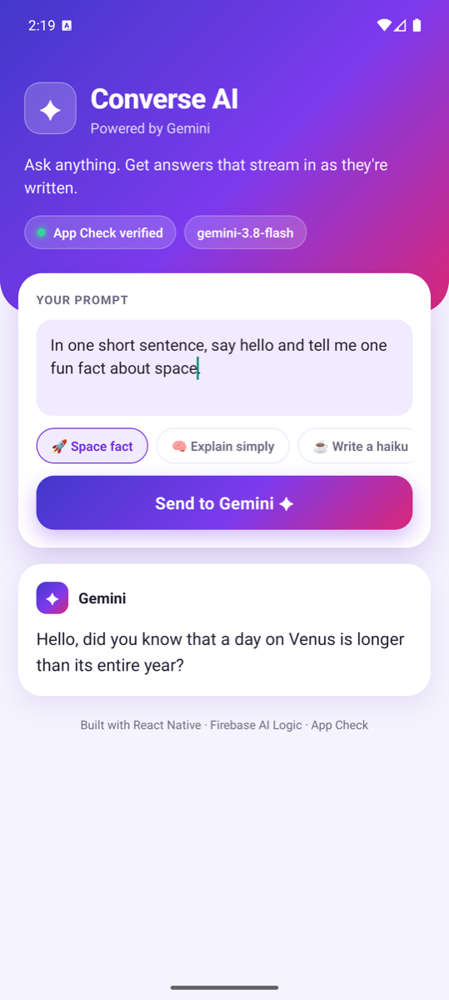

# Converse AI

A React Native app that streams answers from **Google's Gemini** through **Firebase AI Logic**, with every request protected by **Firebase App Check**.

<p align="center">
  
</p>

## Features

- **Streaming replies.** Answers appear word by word as Gemini writes them (`generateContentStream`).
- **App Check enforced.** Only the genuine app can call Gemini on this Firebase project. Debug builds use the App Check debug provider; release builds use Play Integrity (Android) and App Attest (iOS).
- **No API key in the app.** Gemini is called through Firebase AI Logic, so there's no Gemini API key to ship or leak.
- **Helpful errors.** Common setup problems (missing config, App Check rejected, model not found, quota) show the step that fixes them.
- **Prompt suggestions.** One-tap chips to try different kinds of prompts.

## Tech stack

| | |
| --- | --- |
| App | React Native 0.87 (bare CLI), TypeScript |
| AI | Firebase AI Logic (`@react-native-firebase/ai`) with the Gemini Developer API |
| Security | Firebase App Check (`@react-native-firebase/app-check`) |
| Tests | Jest + React Test Renderer |

## Run it yourself

You need Node 22.11+, Android Studio (for Android) or Xcode 26.2+ (for iOS), and a free Firebase project.

### 1. Install

```bash
git clone https://github.com/vrinda27/converse-ai.git
cd converse-ai
npm install
bundle install                                  # iOS, first time only
cd ios && bundle exec pod install && cd ..      # iOS
```

### 2. Set up Firebase

1. In the [Firebase console](https://console.firebase.google.com/), create a project.
2. Go to **AI Services > AI Logic**, click **Get started** and choose **Gemini Developer API**.
3. Add an **Android app** with package name `com.geminichat`. Download `google-services.json` to `android/app/google-services.json`.
4. Add an **iOS app** with bundle ID `com.geminichat`. Download `GoogleService-Info.plist` to `ios/GeminiChat/GoogleService-Info.plist` (it's already linked in Xcode).

Both config files are in `.gitignore`, so each person uses their own Firebase project.

### 3. App Check

1. In the console go to **Security > App Check**, click **Get started**, then **Register** each app (Play Integrity for Android, App Attest for iOS).
2. On an app's **⋮** menu, open **Manage debug tokens > Add debug token > Generate token**. Add the same token to the other app.
3. Copy `src/debugToken.example.ts` to `src/debugToken.ts` and paste the token in. This file is in `.gitignore`.
4. Optional: under **App Check > APIs > Firebase AI Logic**, set baseline protection to **Enforced**.

### 4. Run

```bash
npm run android
npm run ios
```

The header shows **App Check verified** when the token is accepted. Tap **Send to Gemini** to stream a reply.

## Troubleshooting

| You see | Fix |
| --- | --- |
| Android: "File google-services.json is missing". iOS: "Build input file cannot be found: GoogleService-Info.plist" | The config file is missing or in the wrong place (step 2). |
| Android: "SDK location not found" | Create `android/local.properties` with `sdk.dir=/path/to/Android/sdk`. |
| App Check failed | The token in `src/debugToken.ts` isn't registered for that app in the console. Uninstall the app and run it again after fixing. |
| 403, "has not been used" or "is disabled" | AI Logic or App Check isn't set up for the project (steps 2 and 3). |
| 404 / model not found | Update `MODEL_NAME` in `src/firebase.ts` to a current model from the [models page](https://firebase.google.com/docs/ai-logic/models). |
| 429 | Free quota hit. Wait a minute. |
| `pod install` says SPM + static linkage isn't supported | Keep `use_frameworks! :linkage => :dynamic` in `ios/Podfile`. |

## Roadmap

- [ ] Multi-turn chat with `model.startChat()` and chat bubbles
- [ ] Stop button to cancel a reply mid-stream
- [ ] Model name and system prompt in Firebase Remote Config
- [ ] App Check replay protection with limited-use tokens

## Scripts

`npm run typecheck` · `npm run lint` · `npm test`

## Docs

- [React Native Firebase: AI Logic](https://rnfirebase.io/ai/usage)
- [React Native Firebase: App Check](https://rnfirebase.io/app-check/usage)
- [Firebase AI Logic: Get started](https://firebase.google.com/docs/ai-logic/get-started)
